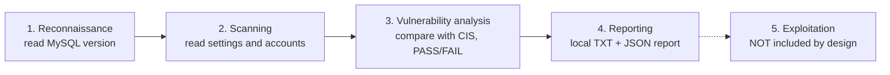
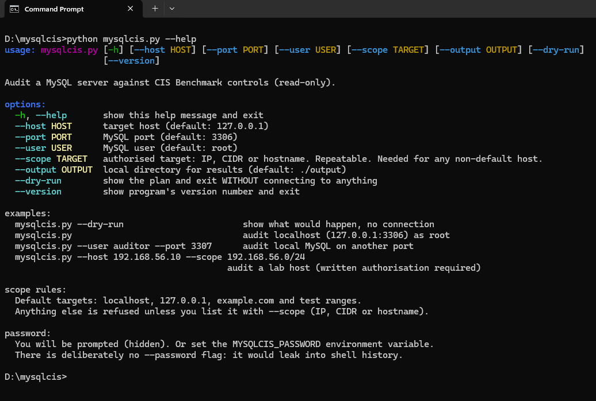
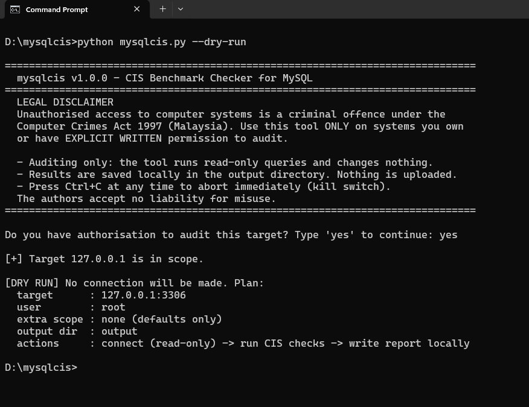
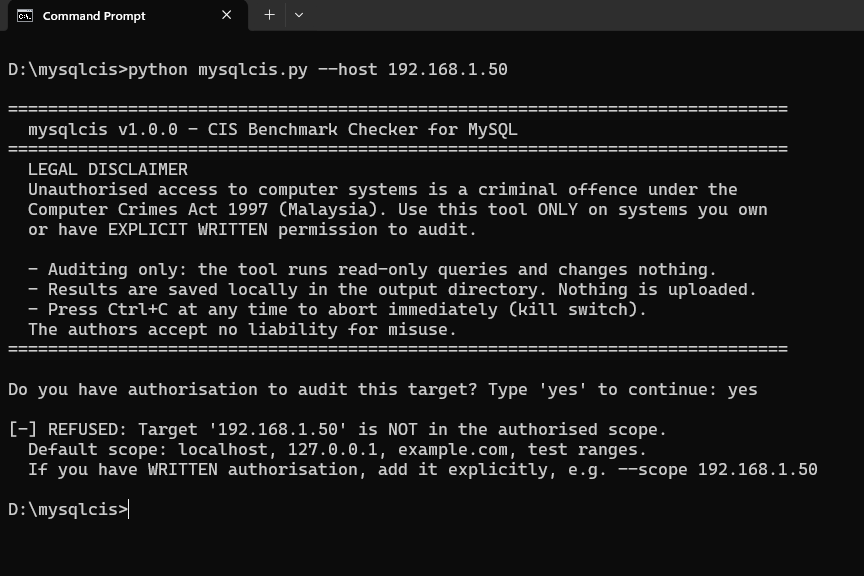
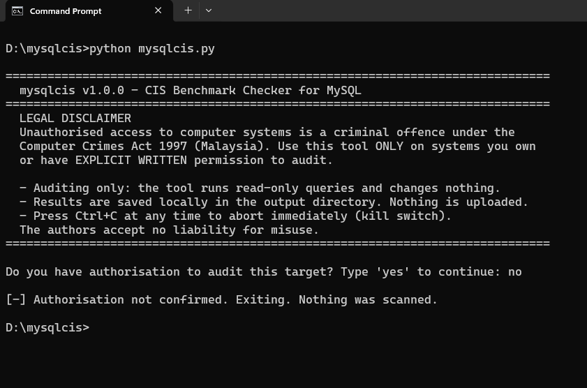
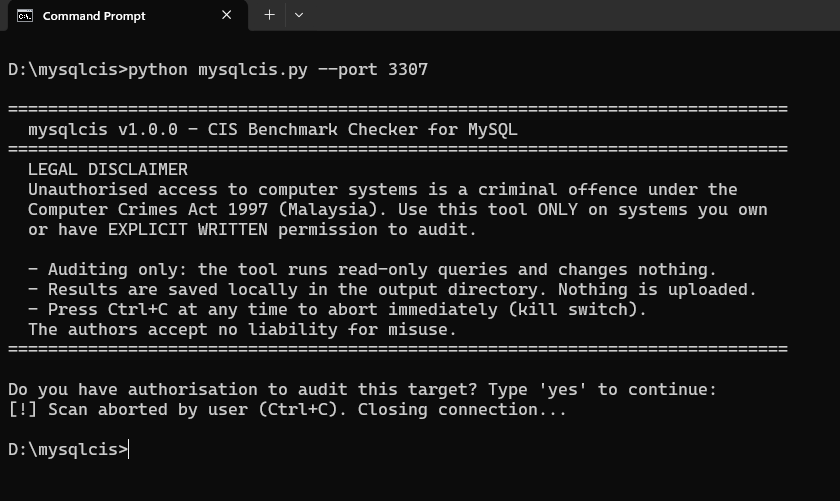
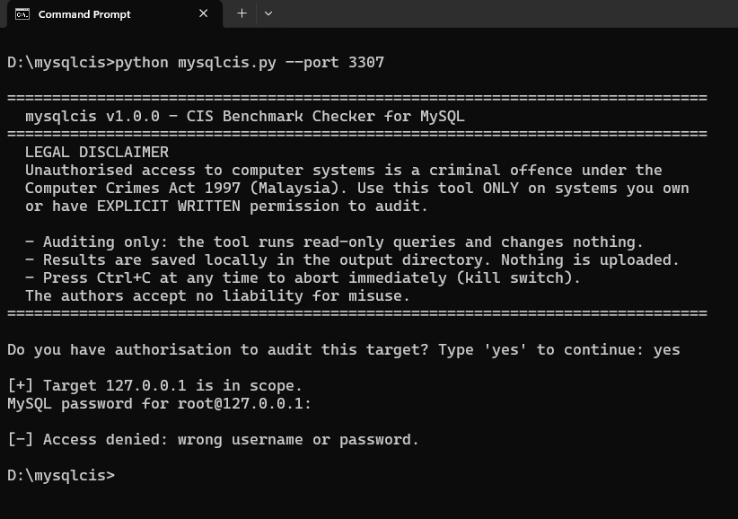
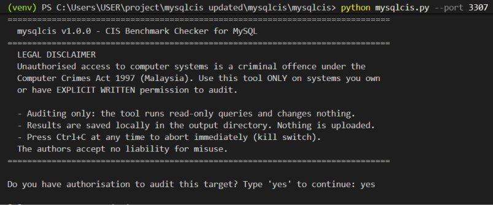
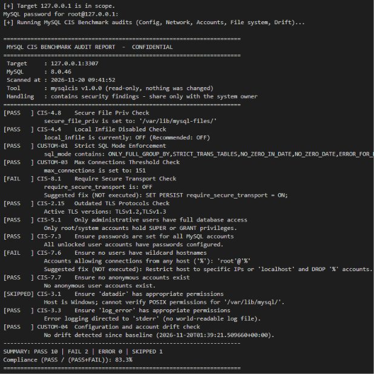
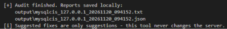

# mysqlcis

**A read-only CIS Benchmark checker for MySQL 8.0**

   

> Course: IKB31603 Ethical Hacking, UniKL MIIT (October 2026)

> Assessment: Ethical Hacking Tool Development

> Team: UMAIR BIN NOR AZAM | MUHAMMAD FARIS BIN ARSAD | EYMAN BIN MOHD ZOOL-KHAZRIN | NUR ALIA MAISARAH BINTI ABD RAHAMAN 

---

## Table of contents

1. [Description](#1-description)
2. [Attack category](#2-attack-category)
3. [Attack lifecycle mapping](#3-attack-lifecycle-mapping)
4. [Checks implemented](#4-checks-implemented)
5. [Installation](#5-installation)
6. [Usage](#6-usage)
7. [Screenshots](#7-screenshots)
8. [Ethical considerations](#8-ethical-considerations)
9. [Rules of Engagement (RoE)](#9-rules-of-engagement-roe)
10. [Responsible disclosure](#10-responsible-disclosure)
11. [Legal disclaimer](#11-legal-disclaimer)
12. [Limitations](#12-limitations)
13. [Project structure](#13-project-structure)
14. [Credits, references and license](#14-credits-references-and-license)

---

## 1. Description

`mysqlcis` is a Python command-line tool that checks the configuration of a MySQL 8.0 server against recommendations from the *CIS Oracle MySQL Enterprise Edition 8.0 Benchmark v1.5.0*. It connects to a server, runs 13 checks and saves a PASS / FAIL report on the local computer.

The tool is **read-only**. It can look at settings and accounts, but it cannot change anything on the server. Suggested fixes appear in the report, but the tool never runs them.

**Why it exists:** MySQL servers are often left with weak settings (no encryption, file import enabled, accounts open to every host). Checking each setting by hand takes a long time, so the tool automates it.

**Main features**

| Feature | What it does |
|---|---|
| 13 checks (10 from CIS, 3 custom) | Server settings, TLS, accounts, file permissions, drift |
| Labelled reports | `.txt` and `.json`, with target, MySQL version and timestamp |
| Scope enforcement | Refuses any target that is not on the safe list or `--scope` |
| Legal banner | Cites the Computer Crimes Act 1997, and the user must type `yes` |
| Dry run | `--dry-run` shows the plan without connecting |
| Kill switch | `Ctrl+C` stops cleanly and closes the connection |
| Drift check | Compares accounts and settings with a saved baseline |

## 2. Attack category

**Category 5: Auditing** (CIS benchmark checker).

## 3. Attack lifecycle mapping

mysqlcis covers the assessment stages of the lifecycle. Exploitation is left out on purpose.



| Stage | What the tool does | Output |
|---|---|---|
| 1. Reconnaissance | Connects to the chosen target and reads the MySQL version | Version in the report header |
| 2. Scanning / enumeration | Reads server variables and the account list (`SHOW GLOBAL VARIABLES`, `mysql.user`), and file permissions when run on the same host | Raw values per check |
| 3. Vulnerability analysis | Compares each value with the CIS audit rule and marks it PASS, FAIL, ERROR or SKIPPED | Status per check |
| 4. Reporting | Saves a labelled report with evidence and suggested fixes | `output/mysqlcis_<host>_<time>.txt/.json` |
| 5. Exploitation | **Not included.** No password guessing, no changes, no reading table data | None |

## 4. Checks implemented

| ID | Check | PASS when | Level |
|---|---|---|---|
| CIS-4.4 | `local_infile` | It is OFF | 1 |
| CIS-4.8 | `secure_file_priv` | A folder path or NULL (empty fails) | 1 |
| CIS-8.1 | `require_secure_transport` | It is ON | 1 |
| CIS-2.15 | TLS versions | `TLSv1` and `TLSv1.1` are not enabled | 2 |
| CIS-5.1 | Administrative rights | Only root and system accounts have SUPER or GRANT | 1 |
| CIS-7.3 | Account passwords | No unlocked account has an empty password | 1 |
| CIS-7.6 | Wildcard hosts | No account uses host `%` | 1 |
| CIS-7.7 | Anonymous users | No account with an empty username | 1 |
| CIS-3.1 | `datadir` permissions | Mode 750 or stricter | 1 |
| CIS-3.3 | `log_error` file permissions | Mode 600 (or logs go to stderr) | 1 |
| CUSTOM-01 | Strict SQL mode | `sql_mode` has `STRICT_ALL_TABLES` or `STRICT_TRANS_TABLES` | Custom |
| CUSTOM-03 | `max_connections` | 500 or lower | Custom |
| CUSTOM-04 | Drift | Accounts and settings match the saved baseline | Custom |

Checks marked *Custom* are the team's own additions and are not CIS requirements.

**Result statuses**

| Status | Meaning |
|---|---|
| PASS | Setting meets the rule |
| FAIL | Setting does not meet the rule. A suggested fix is shown (not executed) |
| ERROR | The check could not run, for example a query failed or permissions are missing |
| SKIPPED | Not applicable here, for example file checks on Windows or a Docker or remote server |

Compliance is shown as `PASS / (PASS + FAIL)`. ERROR and SKIPPED are not counted.

## 5. Installation

**Requirements:** Python 3.9 or newer, and a MySQL 8.0 server you are allowed to test.

```bash
git clone https://github.com/<username>/mysqlcis.git
cd mysqlcis
python -m venv venv
venv\Scripts\activate          # Windows
# source venv/bin/activate     # Linux / macOS
pip install -r requirements.txt
```

**Test lab (recommended, uses Docker):**

```bash
docker run -d --name testmysql -e MYSQL_ROOT_PASSWORD=test123 -p 3307:3306 mysql:8.0
```

Wait about 30 seconds until `docker logs testmysql --tail 5` shows *ready for connections*. Use `mysql:8.0` (the tag `mysql:8` installs 8.4, which this benchmark does not cover).

## 6. Usage

```text
python mysqlcis.py [-h] [--host HOST] [--port PORT] [--user USER]
                   [--scope TARGET] [--output OUTPUT] [--dry-run] [--version]
```

| Option | Meaning | Default |
|---|---|---|
| `--host` | Target host | `127.0.0.1` |
| `--port` | MySQL port | `3306` |
| `--user` | MySQL user | `root` |
| `--scope` | Extra authorized target (IP, CIDR or hostname). Repeatable. Needed for any non-default host | none |
| `--output` | Local output folder | `./output` |
| `--dry-run` | Show the plan and exit without connecting | off |
| `--version` | Show the version | |

**Password:** typed at a hidden prompt, or set in the `MYSQLCIS_PASSWORD` environment variable. There is deliberately **no `--password` option**, because it would leak into shell history.

**Examples**

```bash
# 1. See what would happen (no connection)
python mysqlcis.py --dry-run

# 2. Audit the local Docker test lab
python mysqlcis.py --port 3307

# 3. Audit a lab host you are authorized to test (written permission required)
python mysqlcis.py --host 192.168.56.10 --scope 192.168.56.0/24 --user auditor

# 4. Save reports to another folder
python mysqlcis.py --port 3307 --output results
```

**Exit codes**

| Code | Meaning |
|---|---|
| 0 | Completed |
| 1 | Authorization not confirmed (user did not type `yes`) |
| 2 | Target out of scope (refused) |
| 3 | Connection failed |
| 130 | Stopped by the user with `Ctrl+C` |

**Output files** (in `output/`, git-ignored)

| File | Content |
|---|---|
| `mysqlcis_<host>_<YYYYMMDD_HHMMSS>.txt` | Human-readable report |
| `mysqlcis_<host>_<YYYYMMDD_HHMMSS>.json` | Same results in JSON |
| `baseline.json` | Saved snapshot for the drift check (first run creates it, later runs compare) |

**Recommended audit account (least privilege).** Instead of `root`, create a dedicated account on the server you are authorized to audit:

```sql
CREATE USER 'cis_audit'@'localhost' IDENTIFIED BY '<a strong password>';
GRANT SELECT ON mysql.user TO 'cis_audit'@'localhost';
```

Then run `python mysqlcis.py --user cis_audit`. Test it once, and add grants only if a check reports an ERROR for missing permission.

## 7. Screenshots

| | |
|---|---|
|  *Help with usage examples* |  *Dry run, no connection* |
|  *Out-of-scope host refused* |  *Consent not given, tool exits* |
|  *Ctrl+C kill switch* |  *Clear error for wrong password* |




*Full scan of the Docker test lab*

## 8. Ethical considerations

Each safety feature reduces a specific risk. The order of operations is: confirm permission, check scope, and only then connect.

| Safety feature | How it works | Why |
|---|---|---|
| Legal banner and consent | Shown on every run. The user must type `yes` or the tool exits | The user accepts responsibility before anything happens |
| Scope enforcement | Only the safe defaults are allowed unless `--scope` is given. Checked before any connection | Stops scanning the wrong server by mistake |
| No scope tricks | Hostnames are resolved to IPs and checked. `*` and `0.0.0.0/0` are rejected | Scope cannot be widened accidentally |
| Safe defaults | Default target is `127.0.0.1:3306`. Connection timeout is 5 seconds | A wrong run stays local and does not hang |
| Dry run | `--dry-run` prints the plan without connecting | The system owner can review before approving |
| Read-only | Queries that do not start with `SELECT`, `SHOW` or `DESCRIBE` are blocked | The database cannot be changed by the tool |
| Password safety | Hidden prompt or environment variable. No password option. Not stored, logged or printed | Avoids leaks through shell history |
| Clear errors | Wrong password or unreachable server gives a short message, no stack trace | No internal details leaked |
| Kill switch | `Ctrl+C` stops the tool and closes the connection | The user can stop at any time |
| Data handling | See below | Reports contain sensitive findings |

**Data handling**

- The tool collects only configuration values, account names and host patterns. It never reads table data and never reads password hashes.
- Results are written only to the local `output/` folder with a clear label (target, time, "CONFIDENTIAL").
- Nothing is sent over the network except the MySQL connection to the target itself.
- `output/` is listed in `.gitignore` so reports are never committed to Git.
- The drift baseline (`output/baseline.json`) stores account names and setting values only.
- Delete reports when the engagement ends, as agreed with the system owner.

## 9. Rules of Engagement (RoE)

This section must be agreed **in writing** with the system owner before every audit.

**Authorized scope**

- Only systems you own, or systems for which you hold written permission from the owner.
- Default safe targets: `localhost`, `127.0.0.1`, `::1`, `example.com`, `127.0.0.0/8`, and the documentation ranges `192.0.2.0/24`, `198.51.100.0/24`, `203.0.113.0/24`.
- Anything else must be listed explicitly with `--scope` and be named in the written authorization.
- Audit only the MySQL server named in the authorization (host and port).

**Time windows**

- Run only inside the time window written in the authorization (date, start and end time).
- Prefer off-peak hours. A normal scan finishes in seconds and sends light read-only queries, but the owner decides the window.
- Outside the window, do not run the tool.

**Permitted techniques**

- Read-only queries: `SELECT`, `SHOW`, `DESCRIBE`.
- Reading file permissions of the data folder and error log, only when the tool runs on the same machine as the server.
- Writing reports and the drift baseline to the local `output/` folder.

**Prohibited actions**

- Scanning any host that is not in scope, or without written permission.
- Changing the server in any way (no `INSERT`, `UPDATE`, `DROP`, `GRANT`, `SET`, and so on), and running the suggested fixes automatically.
- Guessing or brute-forcing passwords, or using accounts you were not given.
- Reading, copying or exporting table data or password hashes.
- Uploading, emailing or publishing reports outside the agreed people.
- Removing or bypassing the legal banner, consent prompt, scope check or read-only guard.
- Running the tool against production systems without the owner's approval.

**Emergency stop**

1. Press `Ctrl+C` in the terminal. The tool stops and closes the connection (exit code 130).
2. If the terminal does not respond, close the terminal window or end the Python process.
3. Tell the system owner or DBA immediately if the server slowed down or behaved unexpectedly.
4. Ask the owner to lock or remove the audit account if needed.
5. Write down what happened (time, target, what was running) and keep it for the report.
6. In the Docker test lab: `docker stop testmysql`.

## 10. Responsible disclosure

**Findings about a system you audited**

| Question | Guidance |
|---|---|
| **Who** | Report only to the system owner or their designated security contact named in the authorization. Not to the public, social media or other people |
| **When** | Tell the owner as soon as possible. For serious findings (for example remote `root` access or empty passwords), report the same day. For other findings, within 5 working days |
| **How** | Use a private channel (the contact in the authorization, or encrypted email). Send the check ID, the status line from the report, and the suggested fix. Do **not** include data, passwords or full reports in open chat |
| **After** | Give the owner reasonable time to fix (we suggest 90 days) before discussing the issue anywhere else, and only with the owner's permission |
| **Cleanup** | Delete or securely store the report once the owner confirms receipt |

**Vulnerabilities in mysqlcis itself**

- Use GitHub: **Security tab > Report a vulnerability** on this repository (private advisory).
- Or contact: `[team contact email]`.
- Please do not open a public issue for a security problem. We aim to reply within 7 days.

## 11. Legal disclaimer

Unauthorised access to computer systems is a criminal offence under the **Computer Crimes Act 1997 (Akta Kesalahan Komputer 1997, Act 563) of Malaysia**, including unauthorised access to computer material, access with intent to commit further offences, and unauthorised modification of computer contents.

This tool is made for **education and authorized security auditing only**. Use it only on systems you own or have **explicit written permission** to test. The authors accept no liability for misuse or damage. By typing `yes` at the start of a run, you confirm that you have this authorization.

## 12. Limitations

- Covers **13 checks**, which is a small part of the full CIS benchmark.
- The benchmark is for **MySQL Enterprise Edition 8.0**. The tool was tested on MySQL 8.0 Community (Docker). Enterprise-only controls, such as the audit plugin, are not included. MySQL 8.4 and other versions are not covered.
- **File checks (3.1 and 3.3) work only on Linux, on the same machine as the server.** On Windows, in Docker, or on a remote server they show SKIPPED.
- Account checks need permission to read `mysql.user`. Without it they show ERROR.
- The drift check reports PASS on its first run because it only saves the baseline. Comparison starts on the second run.
- The read-only protection is enforced inside the tool (only `SELECT`, `SHOW` and `DESCRIBE` are allowed). It is not also enforced by a read-only database session, so use a low-privilege audit account where possible.
- The default user is `root` for convenience in the test lab. Real audits should use a dedicated account.
- Reports are plain TXT and JSON. There is no HTML report or weighted score yet.
- No automated test suite is included yet.

## 13. Project structure

```text
mysqlcis/
├── mysqlcis.py          # CLI, banner, consent, scope, password prompt, kill switch
├── core/
│   ├── scope.py         # authorized scope rules
│   ├── connector.py     # read-only MySQL connector
│   └── runner.py        # runs all checks and writes the reports
├── checks/
│   ├── base.py          # base class for checks
│   ├── config.py        # 4.4, 4.8, custom SQL mode, max_connections
│   ├── network.py       # 8.1, 2.15
│   ├── accounts.py      # 5.1, 7.3, 7.6, 7.7
│   ├── filesystem.py    # 3.1, 3.3
│   └── drift.py         # baseline comparison
├── docs/                # screenshots
├── output/              # reports (git-ignored)
├── requirements.txt
├── LICENSE
└── README.md
```

| Member | Responsibility |
|---|---|
| Umair | Core and safety: CLI, banner, scope, connector, kill switch |
| Faris | Config and network checks |
| Eyman | Account, file system and drift checks |
| [Member 4] | Runner, README, report, GitHub release |

## 14. Credits, references and license

- Center for Internet Security. (2025). *CIS Oracle MySQL Enterprise Edition 8.0 benchmark* (Version 1.5.0). https://www.cisecurity.org/cis-benchmarks
- Oracle Corporation. (n.d.). *MySQL 8.0 reference manual*. https://dev.mysql.com/doc/refman/8.0/en/
- Computer Crimes Act 1997, Act 563 (Malaysia).
- Arkko, J., Cotton, M., & Vegoda, L. (2010). *IPv4 address blocks reserved for documentation* (RFC 5737). https://www.rfc-editor.org/info/rfc5737
- PyMySQL contributors. (n.d.). *PyMySQL documentation*. https://pymysql.readthedocs.io/

The CIS benchmark document is not included in this repository. Download it from the CIS website.

Released under the **MIT License**. See [LICENSE](LICENSE).
